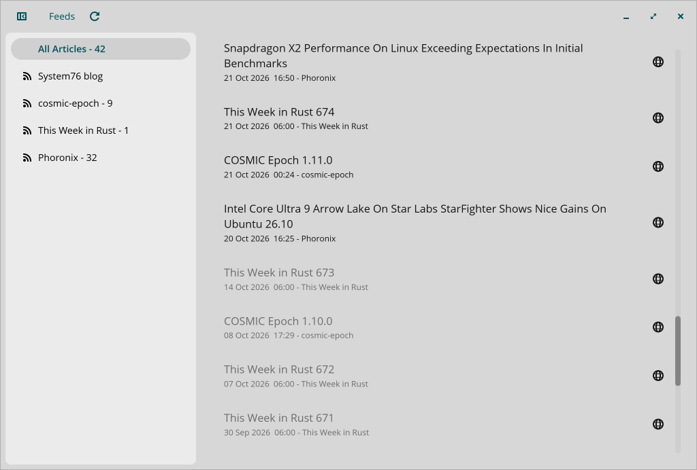
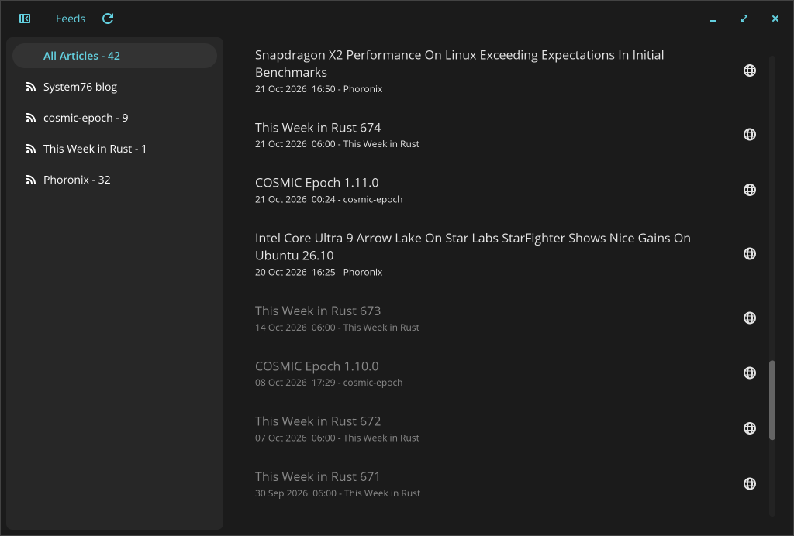

# cosmic-rss

A simple RSS reader built with [libcosmic](https://github.com/pop-os/libcosmic) and Rust, designed for the COSMIC desktop environment on Linux.

> **About this fork:** this repository is a fork of [Arunhegde1231/CosmicRSS](https://github.com/Arunhegde1231/CosmicRSS). All modifications in this fork were made by AI based on my requests. I also wanted to experiment with LLMs, so rather than relying on frontier AI models, I'm running smaller models locally on my own machine.
>
> This is a personal project, built primarily for my own use. I'm sharing it in case someone else finds it useful, but please keep in mind that I'm not a programmer, and the code may contain bugs, poor implementations, or other issues. I can't guarantee its quality, stability, or reliability.
>
> My goal was simple: get an RSS reader that works for me on COSMIC. Nothing more, nothing less.

---

## Screenshots

| Light | Dark |
| --- | --- |
|  |  |

## What it does

- Fetches articles from RSS and Atom feeds
- Stores them locally in a SQLite database (`~/.local/share/com.example.cosmic-rss/rss.db`) so they persist between launches (To reset to the default feed set, delete the database)
- Add feeds at runtime: **Feeds → Add feed…** in the header - paste a feed URL, no rebuild needed
- Delete feeds: right-click a feed in the sidebar → **Delete feed**
- Rename feeds: right-click → **Rename feed** - the title is preserved across syncs and restarts
- Import/export subscriptions as OPML (**Feeds → Export OPML… / Import OPML…**) - compatible with other feed readers (Reeder, Feedly, NetNewsWire, …)
- Displays feeds in a collapsible sidebar - click a feed to filter articles, "All Articles" shows everything
- Tracks read/unread state: clicking an article row (or opening it in the browser) marks it read, clicking again marks it unread; read articles are dimmed. Read state survives restarts and feed syncs
- Unread counts: each feed in the sidebar shows its unread number ("All Articles" shows the total), and the footer shows the unread count for the current view
- Lazy-loads articles as you scroll, 50 at a time
- Auto-syncs every 15 minutes in the background
- "Refresh" button in the header to trigger an immediate sync

## What it doesn't do (yet)

- No article reading view - titles only, no content or summary pane
- No search
- No notifications
- RSS has no historical pagination, so older articles only accumulate over time as you leave the app running

---

## Requirements

- Podman or Docker - for running the dev container
- App tested on Fedora 45 + Cosmic

## Building

This project ships a [dev container](.devcontainer/devcontainer.json) (Fedora 45) with all system dependencies and the Rust toolchain preinstalled, so there is nothing to set up on the host.

### 1. Open the project

Clone the repository, then open it in an IDE. For example Zed detects the dev container automatically and creates it for you - no extensions or manual setup needed.

### 2. Build inside the dev container

```bash
# Check for errors without building
cargo check

# Release build (optimised, recommended for actual use)
cargo build --release
```

### 3. Run the binary from your host

The built binary is at `target/release/cosmic-rss`.

On first run, `rss.db` will be created in `~/.local/share/com.example.cosmic-rss/`. Delete it to start fresh:

```bash
rm ~/.local/share/com.example.cosmic-rss/rss.db
```

---

## Project structure

```
src/
├── main.rs    # App struct, UI layout, nav sidebar, message handling
├── feed.rs    # Entry and Channel data types
├── opml.rs    # OPML import/export (export_opml / parse_opml)
├── sync.rs    # RSS/Atom fetching, background sync loop
└── db.rs      # SQLite setup, read/write helpers
```

---

## Dependencies

| Crate | Purpose |
|---|---|
| `libcosmic` | Core UI framework (COSMIC desktop) |
| `tokio` | For Async runtime |
| `reqwest` | HTTP client for fetching feeds |
| `rss` | For parsing RSS feeds |
| `quick-xml` | XML parsing for OPML import/export |
| `atom_syndication` | For parsing Atom feeds |
| `rusqlite` | SQLite database (bundled) |
| `chrono` | For date/time parsing and formatting |
| `serde` | Serialisation |
| `anyhow` | Error handling |
| `futures` | Streaming utilities |
